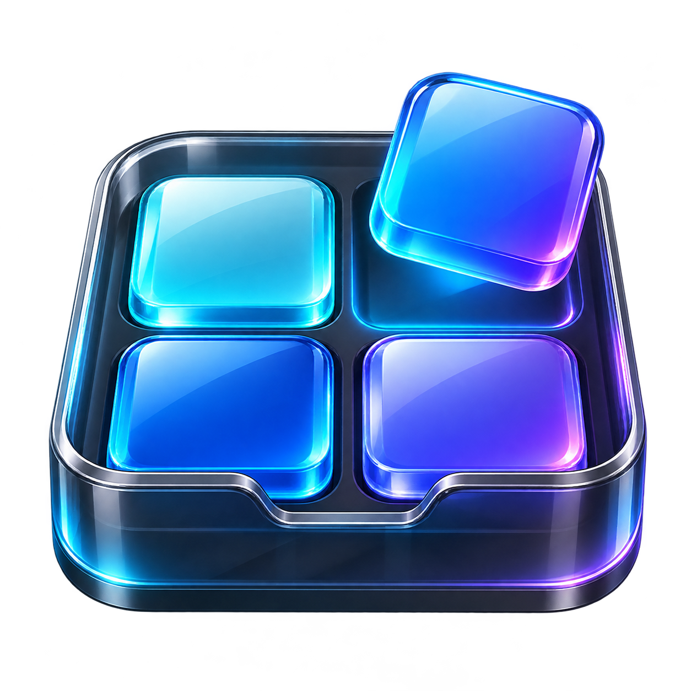
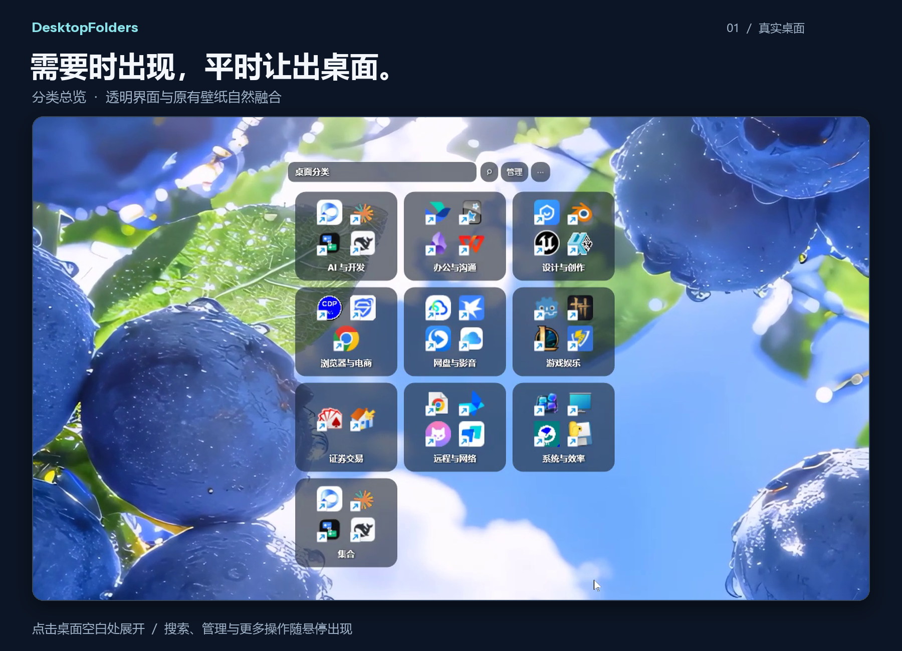
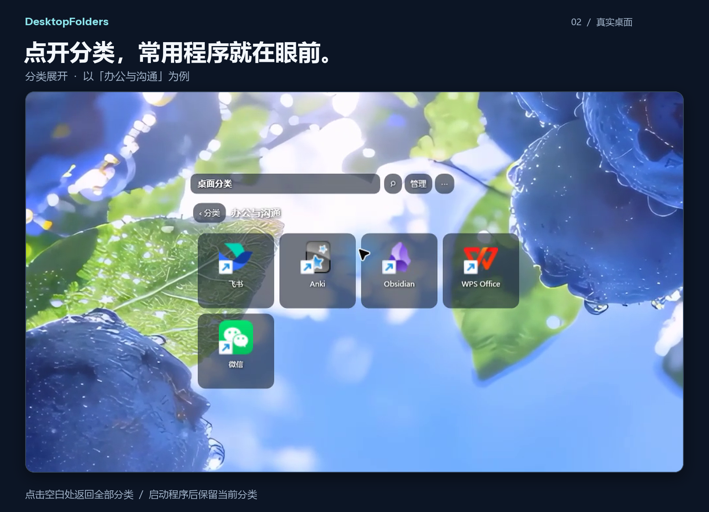
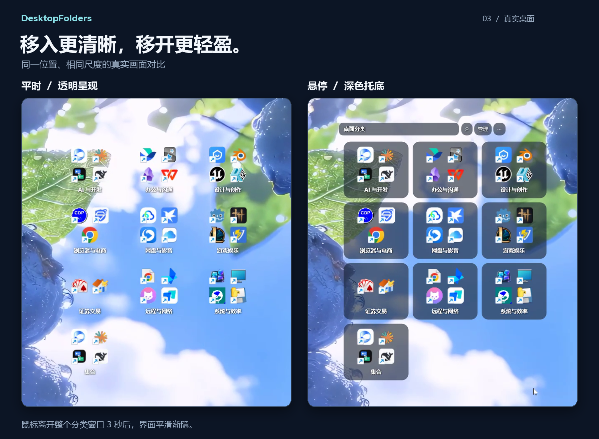

<p align="center">
  
</p>

<h1 align="center">桌面分类 · DesktopFolders</h1>
<p align="center"><strong>需要时出现，平时让出桌面。</strong></p>
<p align="center">一个简单、透明、可自动隐藏的 Windows 桌面快捷方式分类工具。</p>
<p align="center">C# · WPF · .NET Framework 4.8 · Windows x64 · MIT</p>

点击桌面空白处，分类出现；鼠标移入，图标下方浮现深色背景，顶部管理入口同时显示；离开窗口 3 秒后，整个界面平滑渐隐。

日常只需要：**展开 → 找到分类 → 打开程序。** 分类、搜索、布局与设置保存在本地，无需账号。

A minimal Windows desktop shortcut organizer with transparent groups, click-to-reveal, hover controls, and a smooth fade-out.

## 看看效果

### 约 25 秒，看看完整操作

主屏实录，含中文配音和同步文字讲解：**点击空白展开 → 进入分类 → 点击空白返回 → 悬停加深 → 移开后三秒渐隐。** 播放时可点击扬声器图标开启配音。

https://github.com/user-attachments/assets/e2dc83d9-c550-428e-b68e-0e50edd8d8cb

[下载 1080p 原版 MP4（含配音）](https://github.com/cc742768953-bit/DesktopFolders/releases/download/v0.1.0-beta.1/DesktopFolders-demo-v03-1080p.mp4)

视频中的点击与移动位置使用已标注的示意光标；界面、壁纸、悬停和渐隐效果来自主屏实录。悬停段放慢展示，并附移入前后的真实画面对比。

### 界面截图







以上画面取自本机主显示器的原始录屏，保留实际分类、软件图标和蓝莓壁纸；仅做裁切、等比缩放、外框与说明排版。悬停对比采用相同裁切范围。正常使用时，透明窗口会显示你自己的桌面壁纸。

## 下载与开始使用

前往 **[Releases 下载页面](https://github.com/cc742768953-bit/DesktopFolders/releases)**，下载 `DesktopFolders-v…-windows-x64.zip`。

1. 完整解压到一个你有写入权限、准备长期存放的位置。
2. 双击 `DesktopFolders.exe`。
3. 点击桌面空白处，展开分类。

首次运行会复制当前用户和公共桌面中的 `.lnk` / `.url` 快捷方式，按名称规则放入分类。不会移动或删除原桌面文件。自动分组只是起点，可以在“管理”中调整。

软件启动后驻留系统托盘。初次运行会提示展开方式；如果没有看到窗口，可以右键托盘图标，选择“显示分类”或“管理分类”。Windows 可能把托盘图标放在折叠菜单中。

### 希望创建桌面和开始菜单入口？

双击解压目录中的 `Install.cmd`，会安装到当前用户的 `%LOCALAPPDATA%\DesktopFolders` 并创建快捷方式，无需管理员权限。

也可以指定其他盘和开机启动：

```powershell
.\Install.ps1 -InstallDirectory 'D:\Apps\DesktopFolders' -StartWithWindows
```

安装脚本只从发布包的固定文件清单复制程序，不会带入作者配置。更新已有安装时，请先从托盘退出；安装脚本保留目标目录中的分类和快捷方式数据。便携版和安装脚本都需要 .NET Framework 4.8 或更高版本。

## 功能

| 功能 | 使用体验 |
| --- | --- |
| 桌面分类 | 分类小卡片预览最多四个图标，点击展开该分类 |
| 点击展开 | 默认完整隐藏；左键点击桌面空白处，松开后显示所有分类 |
| 自动渐隐 | 离开窗口等待 3 秒，再用 300 毫秒渐隐整个界面 |
| 中途恢复 | 渐隐时移回鼠标，界面恢复；菜单、拖动、对话框期间保持显示 |
| 透明与悬停 | 常态保留图标和分类名；悬停时显示深色托底和顶部操作栏 |
| 常驻模式 | 在“更多”或托盘菜单中切回常驻显示 |
| 图标大小 | 32–64 像素，即时预览，支持保存、取消和恢复默认值 |
| 搜索 | 从所有分类中筛选快捷方式；支持 `Ctrl+F` |
| 分类管理 | 新建、改名、排序、移动快捷方式、拖放添加、移出分类 |
| 空白返回 | 展开分类或搜索后，点击组件空白处或桌面背景，返回所有分类 |
| 保留当前视图 | 点击程序后保留当前分类、搜索与滚动位置 |
| 集合 | 汇总所有分类，按快捷方式目标路径去重 |
| 内置入口 | 提供“此电脑”和“桌面分类”管理入口 |
| 位置管理 | 拖动标题调整位置，支持锁定与恢复默认位置 |
| 配置备份 | 原子写入、上一版备份、JSON 导入与导出 |
| 托盘入口 | 随时显示、管理、切换模式或退出 |

分类中的程序仍由 Windows 按原来的方式启动。DesktopFolders 管理的是入口，不会替你安装这些程序。

## 为什么做这个工具

我们想要的是一个能顺手找到程序、能把壁纸让出来的桌面分类界面。

- **操作直接**：点击展开，找到分类，打开程序。
- **界面安静**：顶部按钮和深色卡片随悬停出现，离开后淡出。
- **尊重已有桌面**：首次导入采用复制，保留原快捷方式和文件。
- **专注分类**：围绕快捷方式、分组、搜索和显示状态展开功能。

## 运行环境

- Windows x64；主要在 Windows 11 上验证。
- [.NET Framework 4.8 或更高版本](https://dotnet.microsoft.com/download/dotnet-framework/net48)。这是传统 Windows .NET 平台，和 .NET 8 是不同的运行环境。
- 应用目录需要写入权限，用于保存配置、复制的快捷方式和图标缓存。

这是独立的 C# / WPF 桌面程序。运行时无需 Codex、Seelen、REA、浏览器或在线服务。Windows 10、混合缩放多显示器、远程桌面和不同壁纸宿主的组合仍需要更多实机反馈。

## 本地数据与卸载

数据保存在程序目录：`config.json`、`config.json.bak`、`Shortcuts/`、`Icons/`，以及运行日志。迁移前请备份整个目录；外部程序也需要在目标电脑上安装，原程序路径可能需要重新关联。

退出后删除程序目录即可移除便携版。通过安装脚本创建的桌面、开始菜单或启动文件夹快捷方式，可一并手动移除。

程序不会自动修改 Windows 原生桌面图标的显示设置。如果希望桌面只保留分类界面，可以自行在桌面右键菜单中调整“查看 → 显示桌面图标”。

## 从源码构建

在 Windows x64、.NET Framework 4.8 环境中运行：

```powershell
.\build.ps1
# 输出：dist\DesktopFolders\DesktopFolders.exe
```

构建脚本使用系统 Framework 目录中的 C# 编译器。可通过 `-OutputDirectory` 指定输出目录。

```powershell
.\scripts\test.ps1
.\scripts\test.ps1 -IncludeUiTests  # 需要可交互的 Windows 桌面
.\scripts\package.ps1
```

发布 ZIP 按固定清单打包，不包含任何运行配置、个人快捷方式、图标缓存、日志或历史备份。GitHub Actions 在 Windows 上构建并执行配置自测。

更多内容：**[使用指南](docs/USAGE.md)** · **[技术说明](docs/ARCHITECTURE.md)** · **[常见问题](docs/FAQ.md)** · **[更新记录](CHANGELOG.md)** · **[参与贡献](CONTRIBUTING.md)**

## 授权与致谢

本项目采用 [MIT License](LICENSE)。桌面分类的交互探索受到 Seelen UI / Orbit Folders 等桌面整理工具的启发；发布内容为独立 C# 实现，不包含原组件代码、主题、二进制或分析材料。

蓝紫玻璃图标由 AI 辅助生成，托盘简化图标由代码绘制，作为本项目资源提供。截图中的第三方软件图标与壁纸来自实际运行环境，相关权利归各自权利人所有；项目不将其作为独立素材分发。
