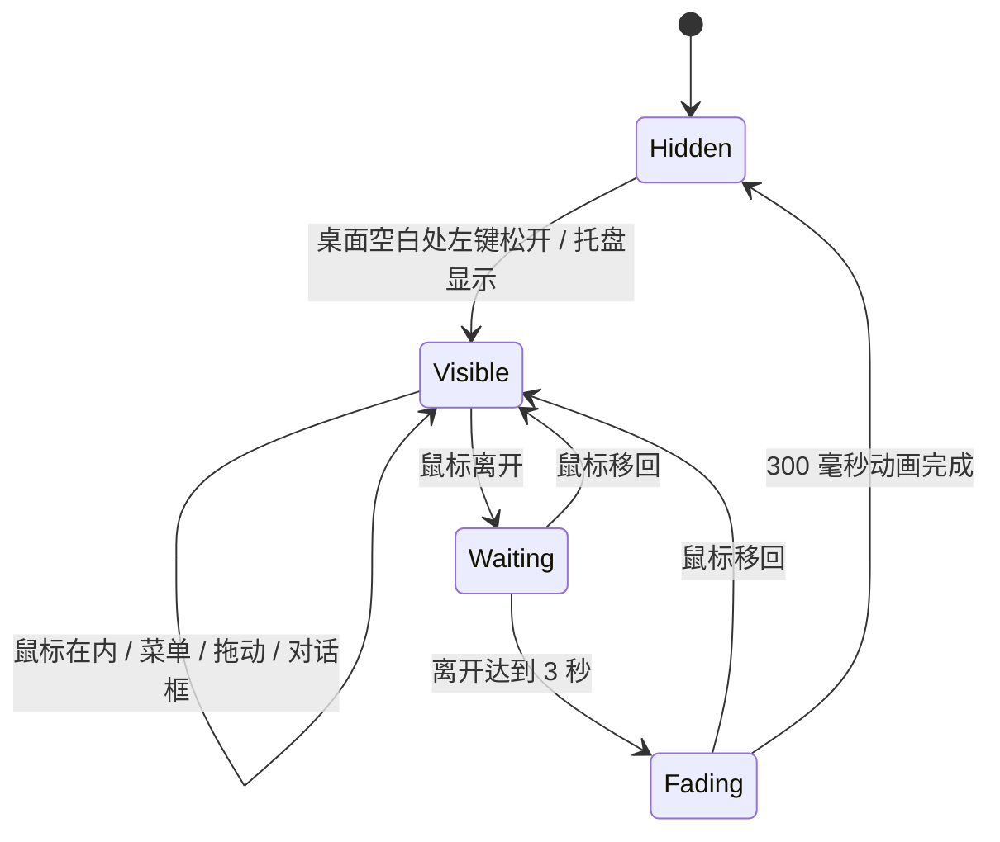

# 技术说明

## 技术组成

| 部分 | 实现 |
| --- | --- |
| 语言与平台 | C#、x64、.NET Framework 4.8 |
| 主界面 | WPF，无边框透明窗口 |
| 视觉效果 | WPF 画刷与透明度动画，圆角卡片和居中布局 |
| 托盘 | Windows Forms `NotifyIcon`，与 WPF 共用进程 |
| Shell 集成 | Win32 API、Windows Shell 图标和 `.lnk` |
| 配置 | UTF-8 JSON，应用目录内保存 |
| 发布 | 独立 EXE、运行配置及可选的用户级安装脚本 |

WPF 是界面框架，.NET Framework 是运行平台。项目不是网页壳，也没有捆绑浏览器。它属于托管 Windows 桌面应用，不应将“Windows 桌面程序”理解为完全不依赖运行环境的纯机器码程序。

## 文件组织

- `src/DesktopFolders.cs`：配置模型、界面、Shell 图标、显示状态、菜单、管理与配置自测。
- `src/FirstRun.cs`：默认分类、桌面快捷方式复制、名称分组和内置入口。
- `src/AssemblyInfo.cs`、`src/app.manifest`：应用标识、普通用户权限与 DPI 声明。
- `assets/`：图标源图与嵌入 ICO。
- `tests/ClickRevealTests.cs`：真实 WPF 窗口上的显示状态与动画测试。
- `build.ps1`、`scripts/`：构建、测试与按清单打包。

## 显示状态

常驻模式不进入整窗隐藏流程。顶部操作和深色托底采用独立的悬停动画，隐藏顶部时保留布局空间，避免分类位置跳动。

窗口完全隐藏后调用 WPF `Hide()`，同时恢复下一次显示需要的基础透明度；隐藏窗口不承担桌面点击命中。可见时的轻量指针检测周期为 100 毫秒，隐藏时停止该计时器。

## 桌面点击与启动保护

点击展开模式安装低级鼠标观察器，仅处理相关左键事件。它判断点击是否落在桌面背景对应的窗口上，其他应用窗口不触发展开；观察器始终继续传递输入，不吞掉原点击。

隐藏时在左键松开后展开，避免新出现的分类按钮处理同一次按下和松开。展开分类后的空白返回使用视图版本校验，启动程序时递增版本，让此前排队的空白返回请求失效。

窗口层级根据启动、失去焦点、显示环境变化等事件维护，不用定时重复置底来维持层级。

## 数据与权限

配置采用先写临时文件、校验、原子替换的方式，上一版保存为 `config.json.bak`。当前配置无法读取时尝试恢复备份，并保留无效原文件。

首次导入只读取桌面顶层 `.lnk` / `.url` 并复制到应用目录；分组为本地关键词规则，不上传文件名。点击网址入口会交给 Windows 默认处理程序。

应用请求普通用户权限，不创建系统服务，不替换 Explorer，不自动修改壁纸或系统桌面图标显示设置。安装脚本只在选择开机启动时创建当前用户启动快捷方式。

## 测试边界

配置自测验证保存、恢复、校验、移动、去重基础与图标加载；UI 测试使用真实 WPF 窗口验证 3 秒宽限期、动画中间态、移回取消渐隐、真正隐藏、再次展开、菜单和对话框保护以及常驻模式。

桌面背景点击依赖实际 Shell 窗口结构。自动化状态测试不能代替不同 Windows 版本、混合 DPI、多显示器、Explorer 重启和动态壁纸宿主的实机验收。性能没有统一基准数据，不宣称“零 CPU”或固定内存占用。
